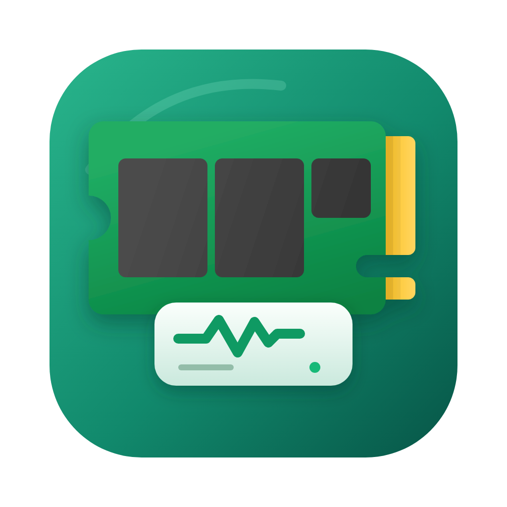
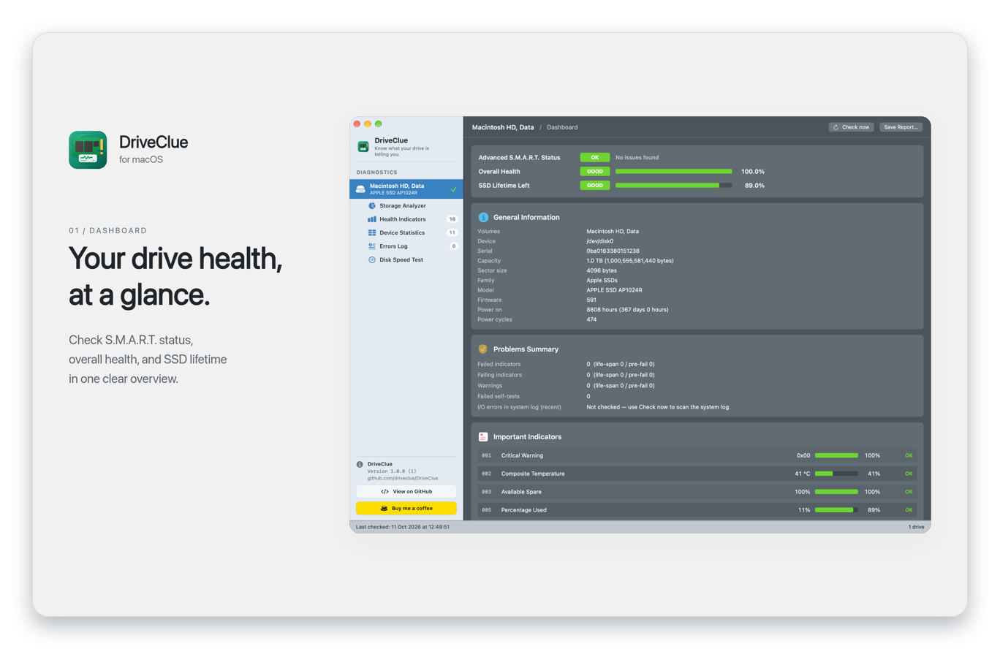
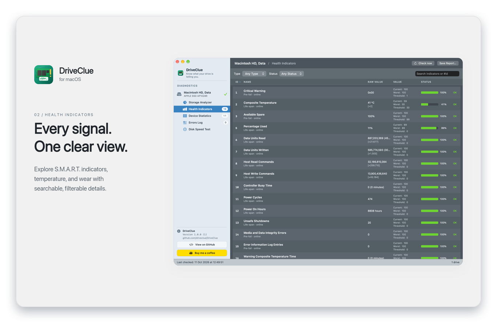
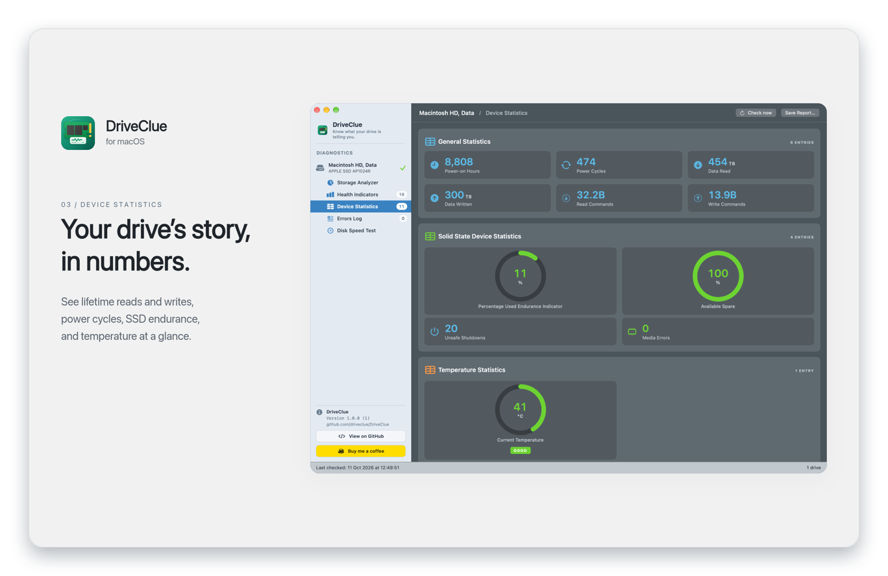
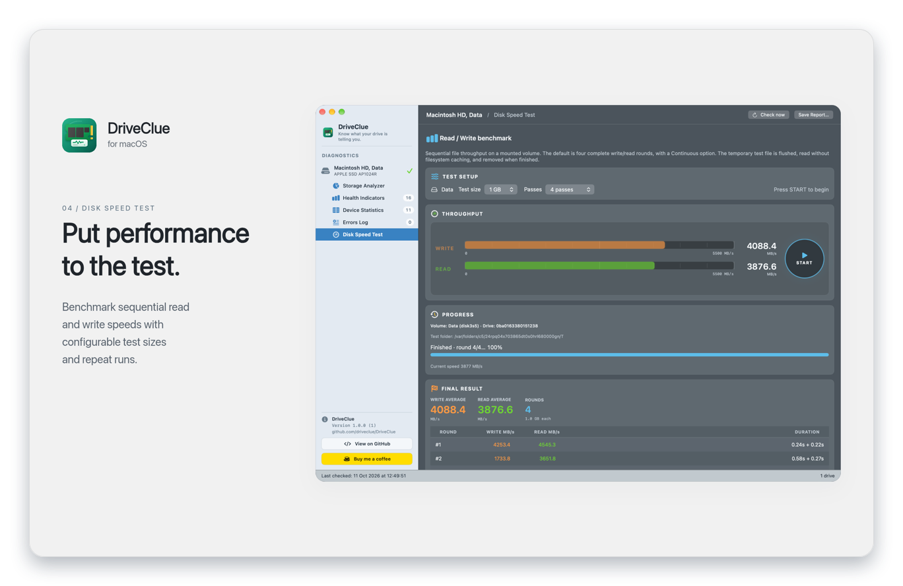
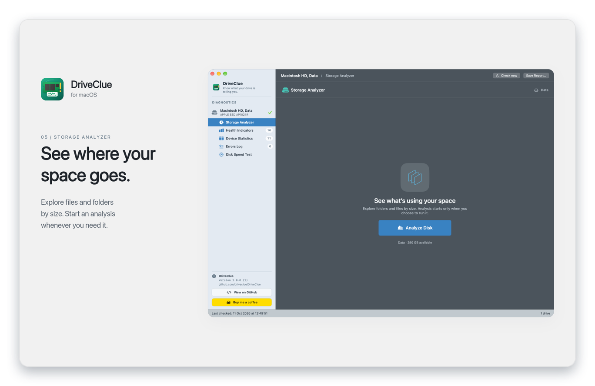

<p align="center">
  
</p>

<h1 align="center">DriveClue</h1>

<p align="center"><strong>Know what your drive is telling you.</strong></p>

<p align="center">
  
  
  
  <a href="LICENSE"></a>
</p>

<p align="center">
  <a href="https://driveclue.github.io/">Website</a> · <a href="https://github.com/driveclue/DriveClue">Source code</a>
</p>

<p align="center">
  A free, open source macOS app for understanding the health of your drives.<br>
  See the important signals, follow changes over time, and know when a drive needs attention.
</p>

## Why DriveClue?

DriveClue turns drive health data into a readable dashboard. It combines an overall health view with the underlying S.M.A.R.T. and NVMe values, so you can see *why* a drive has a particular status.

- **Health at a glance:** overall health, SSD life, temperature, problems, and key indicators.
- **The details when you need them:** searchable health indicators, device statistics, error logs, and ATA self-test results.
- **History on your Mac:** local trends for health, SSD life, temperature, data written, and each health indicator, with a projection of when SSD wear reaches 20%.
- **Storage breakdown:** scan a mounted volume to see which folders and files take the most space, open them in Finder, and move large files to the Trash.
- **Read / write benchmark:** measure sequential filesystem throughput on a mounted volume with a temporary test file, then clean it up automatically.
- **Reports and health warnings:** export the current findings to a file and get a notification when a drive's health status worsens.
- **Menu bar access:** check drive status without keeping the main window open.

## Screenshots

<p align="center">
  <a href="Screenshots/showcase/01-dashboard.png"></a>
  <a href="Screenshots/showcase/02-health-indicators.png"></a>
</p>
<p align="center">
  <a href="Screenshots/showcase/03-device-statistics.png"></a>
  <a href="Screenshots/showcase/04-disk-speed-test.png"></a>
</p>
<p align="center">
  <a href="Screenshots/showcase/05-storage-analyzer.png"></a>
</p>

## Drive support

| Connection | What DriveClue can read |
| --- | --- |
| Internal Apple Silicon NVMe SSD | NVMe health information through macOS, without an administrator password. |
| Internal SATA, Thunderbolt, and eSATA | ATA or NVMe health data, depending on what macOS can read from the drive. |
| USB and FireWire | S.M.A.R.T. data only when a compatible SAT SMART driver is already installed. DriveClue does not install a kernel extension. |

Short and full self-tests are available for supported **ATA** drives. macOS does not expose NVMe self-tests for Apple internal SSDs, so the self-test controls are disabled for those drives. The classic ATA error log is also unavailable for Apple internal SSDs; DriveClue can still show the NVMe error-entry count.

Health percentages are DriveClue's own estimates, based on well-known failure signals such as reallocated or pending sectors, SSD wear, and critical warnings, with CRC errors read as a possible cable problem. Scores may differ from those shown by other drive utilities.

## Get started

DriveClue requires **macOS 14 or later** on Apple Silicon or Intel. To build it, install Xcode and [XcodeGen](https://github.com/yonaskolb/XcodeGen) (`brew install xcodegen`), then run:

```bash
xcodegen generate
xcodebuild -project DriveClue.xcodeproj -scheme DriveClue -configuration Release -destination 'platform=macOS' -derivedDataPath DerivedData build
open DerivedData/Build/Products/Release/DriveClue.app
```

Select a drive in the sidebar to see its dashboard. Use **Check now** to refresh the readings, or open **Storage Analyzer**, **Health Indicators**, **Device Statistics**, **Errors Log**, and **Disk Speed Test** for more detail. The **Disk Speed Test** tab runs a sequential read/write benchmark on mounted volumes. It uses a writable temporary folder on the selected volume, flushes the test file, reads it back with filesystem caching disabled, and removes it when the run ends. If macOS cannot find a writable folder automatically, DriveClue asks you to choose one on that volume. On **Storage Analyzer**, scan a volume to drill into folder sizes and move large files to the Trash; on **Health Indicators**, select an indicator to chart its recorded values. **Save Report…** exports the current findings.

### For contributors

The macOS app is in `App/`; drive reading, scoring, reports, and history are in the `DriveClueCore` Swift package. Run the core tests with:

```bash
swift test --package-path DriveClueCore
```

To inspect the same scan data from the command line:

```bash
swift run --package-path DriveClueCore DriveClueProbe
```

Forks and pull requests are welcome. Please describe what you changed and why, and include a test when the change protects a meaningful behavior.

<details>
<summary>Publishing a release (automatic updates)</summary>

**Start-to-finish guide: [RELEASE_NOTES.md](RELEASE_NOTES.md)** — prerequisites, the release script, verification, and troubleshooting.

DriveClue uses [Sparkle](https://sparkle-project.org) to check GitHub Releases for updates. Installed apps fetch `appcast.xml` from this repository once a day in the background (plus on launch) and offer to download and install a newer version, showing the release notes from the appcast item.

To prepare a release, first commit the chosen version/build in `project.yml` and push a clean `main`. Preparation runs tests, lint, unsigned and universal (Apple Silicon + Intel) Developer ID builds, notarization, signing, and appcast generation **locally only**. It produces two artifacts from the same notarized app: `DriveClue-<version>.zip` for Sparkle updates and `driveclue_<version>_build_<build>_universal.dmg` for first-time downloads (also copied to the gitignored `releases/` folder):

```bash
scripts/release.sh preflight 1.0.1
scripts/release.sh prepare 1.0.1 --notarize driveclue-notary --notes /path/to/notes.html
```

Review `build/release/1.0.1/` and the [release guide](RELEASE_NOTES.md) before any publishing. **Neither command commits, tags, uploads, or publishes.** With separate explicit authorization, `publish-draft` creates the exact-source tag, uploads the ZIP and DMG, and verifies both draft assets; another authorization allows `publish` to make that verified archive a public pre-release. Only after the asset is publicly downloadable, separately authorize committing and pushing the prepared feed to `main` so Sparkle can advertise it. Never run those commands without approval. The final archive must be Developer ID–signed, notarized, stapled, and Sparkle-signed; a development or unsigned build is not a distributable release.

Notarization credentials are stored locally with `xcrun notarytool store-credentials driveclue-notary --apple-id you@example.com --team-id R3YX83R9RQ`. The private Sparkle key must remain outside this repository. See the release guide for prerequisites and smoke gates.

To test an update dialog locally, serve a fake appcast with a higher `sparkle:version` and point the app at it:

```bash
defaults write com.trantuan.driveclue SUFeedURL "http://127.0.0.1:8765/appcast.xml"
```

</details>

## Privacy

DriveClue reads drive health information from macOS and keeps its history on your Mac, in `~/Library/Application Support/DriveStats/history.sqlite` (the folder keeps the project's original working name).

It has no telemetry or accounts and never sends your drive data anywhere. The only network traffic is the update check: the app asks GitHub whether a newer release exists, and downloads one only when you choose to install it. Automatic background checks can be turned off with `defaults write com.trantuan.driveclue SUEnableAutomaticChecks -bool false`; "Check for Updates…" in the app menu always stays manual.

## License and redistribution

Copyright © 2026 Tran Tuan. DriveClue is licensed under the **GNU General Public License v3.0 only** ([GPLv3](LICENSE)). You may use, study, modify, fork, and redistribute the app. If you distribute a modified version, you must license the covered work under GPLv3, preserve the required notices, identify your changes, and provide the corresponding source code to recipients as the license requires.

DriveClue is provided free of charge by this project. **GPLv3 also permits others to charge for copies of their forks.** Recipients keep the right to receive the corresponding source code and to share it further, including for free. The license does not impose a zero-price rule on redistribution.

DriveClue is not affiliated with Binary Fruit or DriveDx.

## Support the project

<a href="https://donorbox.org/donate-to-tranit"></a>
