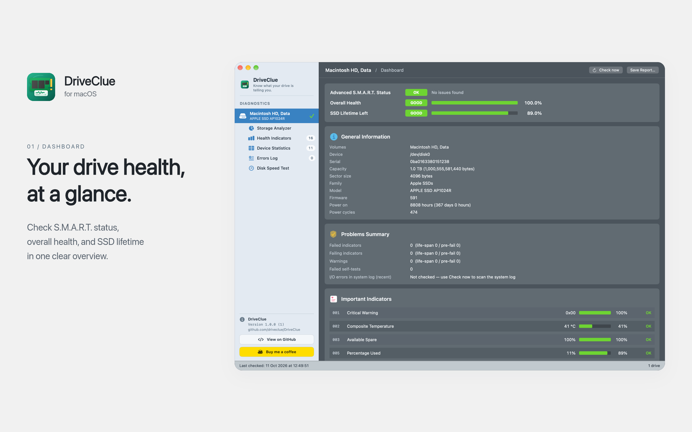
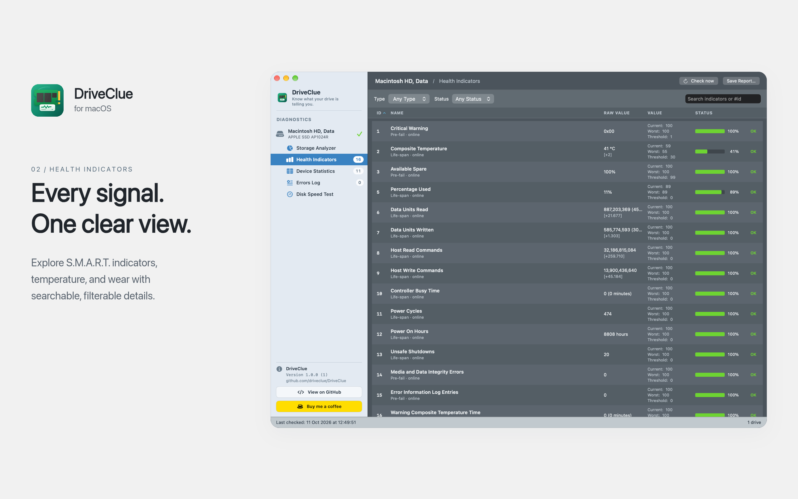
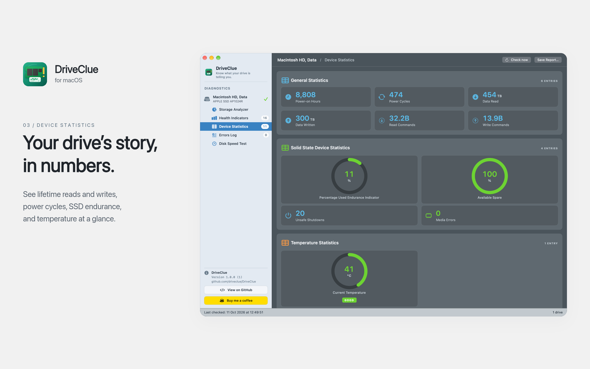
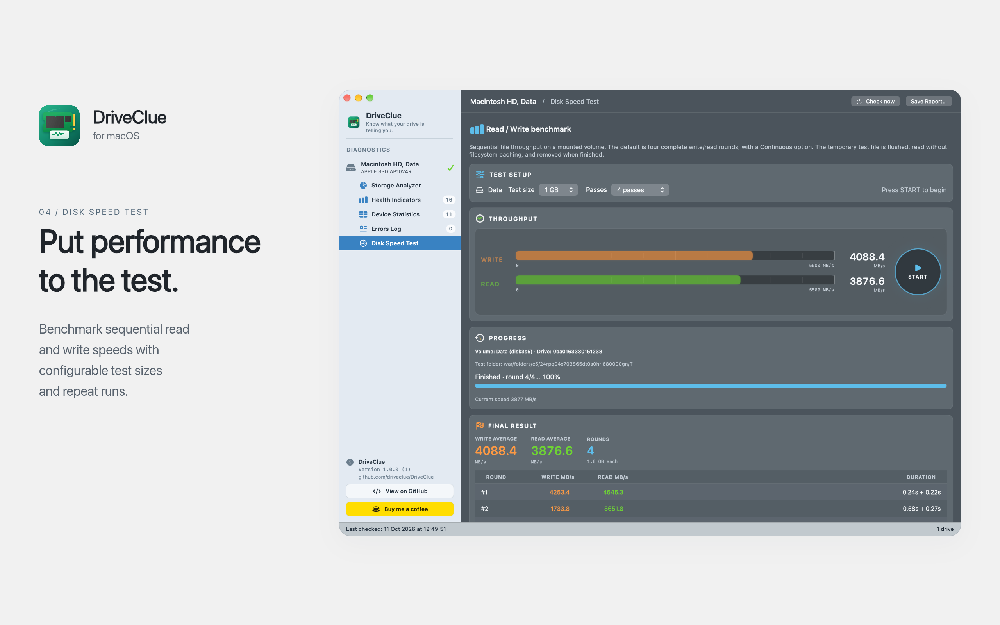
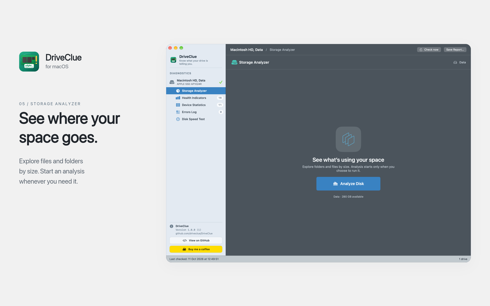

# DriveClue screenshot showcase

Five matching 2560 × 1600 feature cards on a plain light gray background, with dark headlines and short descriptions, made for the DriveClue website and GitHub.

PNG files are the full showcase exports. The `web/` folder contains smaller WebP versions for website use. Original captures are retained in `originals/`. Copy, line breaks, accessible image descriptions, and image dimensions are in [captions.json](captions.json). The built-in imagegen prompts are in [prompts.json](prompts.json).

The final cards use the actual supplied app captures. The narrow exterior capture margins are removed, and each complete app window is scaled uniformly onto the presentation background. Interface text, values, controls, and colors are preserved from the captures.

## Dashboard



**Your drive health, at a glance.** Check S.M.A.R.T. status, overall health, and SSD lifetime in one clear overview.

## Health Indicators



**Every signal. One clear view.** Explore S.M.A.R.T. indicators, temperature, and wear with searchable, filterable details.

## Device Statistics



**Your drive’s story, in numbers.** See lifetime reads and writes, power cycles, SSD endurance, and temperature at a glance.

## Disk Speed Test



**Put performance to the test.** Benchmark sequential read and write speeds with configurable test sizes and repeat runs.

## Storage Analyzer



**See where your space goes.** Explore files and folders by size. Start an analysis whenever you need it.

## GitHub README snippet

Copy this snippet into the repository's root README. The paths assume this folder is committed as `Screenshots/showcase/`.

```markdown
## Screenshots


```

The root README shows these cards two per row using the versions in `readme/`. Those have rounded corners, a soft drop shadow, and transparent padding built in, because GitHub strips CSS from READMEs. After changing the cards, regenerate them on macOS with `swift render-readme.swift` from this folder.

## Website use

Copy the WebP and PNG assets into your website's public asset folder. Use the copy and alt text from `captions.json`.

```html
<picture>
  <source srcset="/screenshots/01-dashboard.webp" type="image/webp">
  
</picture>
```

## Editing and rebuilding

Edit the copy and intentional line breaks in `captions.json`, then run `node render.cjs` from this folder with `sharp` and `@napi-rs/canvas` available on Node's module path. The renderer checks that every text line fits and exports all five PNG and WebP files.

The background edit used built-in imagegen and was normalized to solid light gray (`#F1F1F1`). The renderer adds the real DriveClue brand icon, typesets dark copy, and composites the original screenshots with a subtle window shadow. It uses the locally installed macOS system font, or a font supplied through `SHOWCASE_FONT`; no font files are redistributed.

